# Screenshots

## Windows

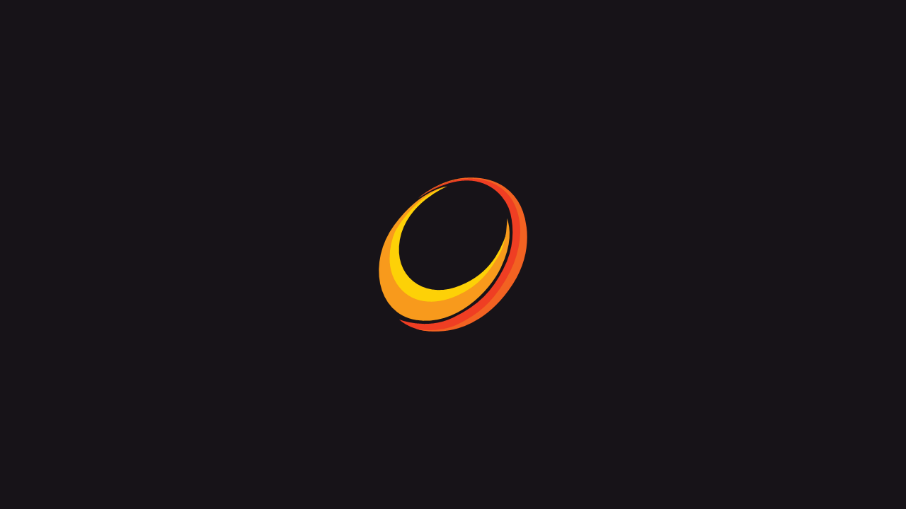


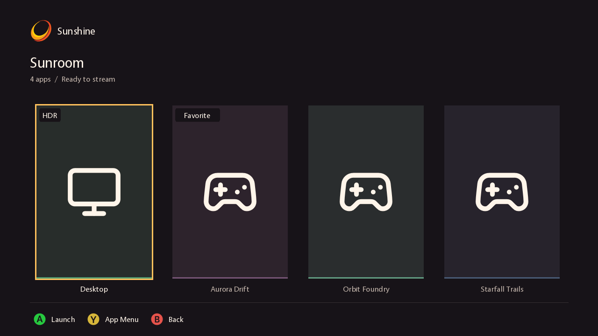

## Original Xbox in xemu

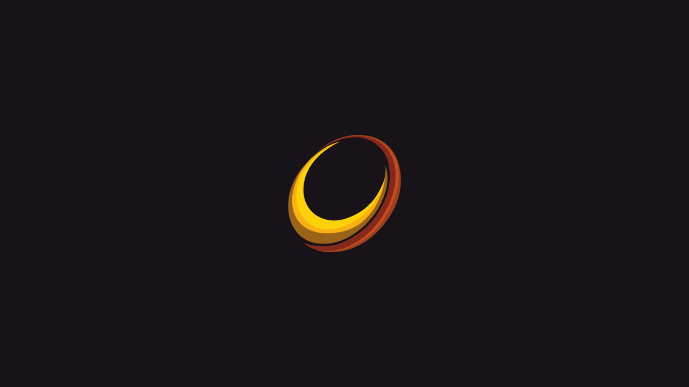

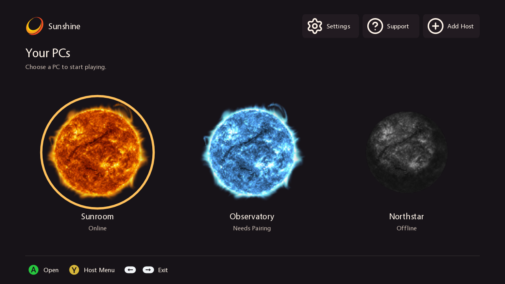

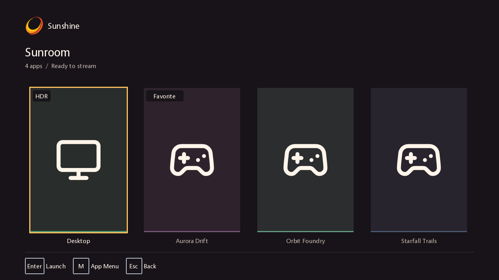

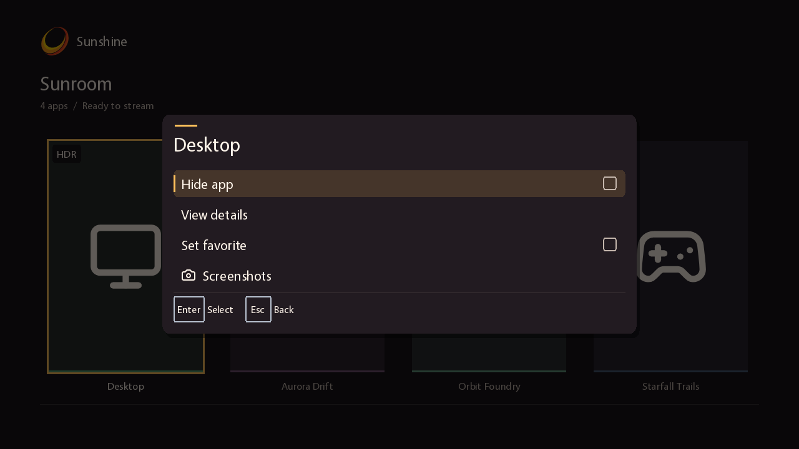

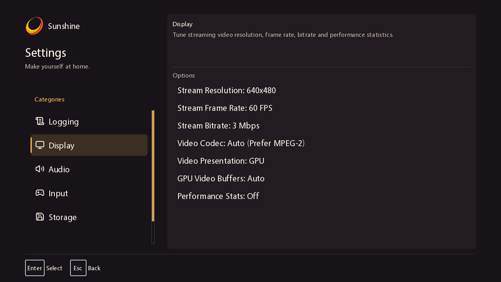

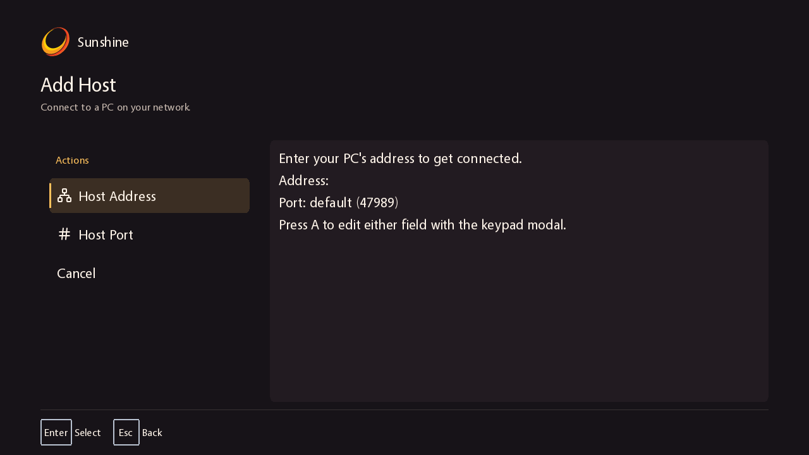

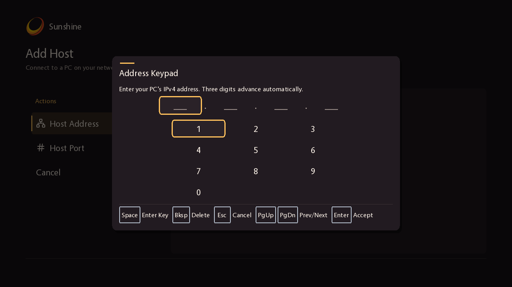

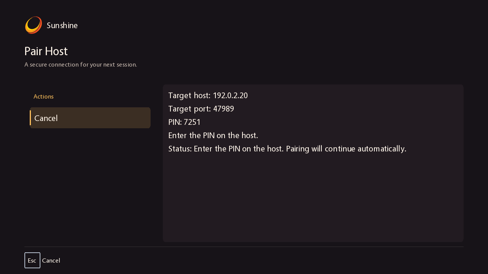

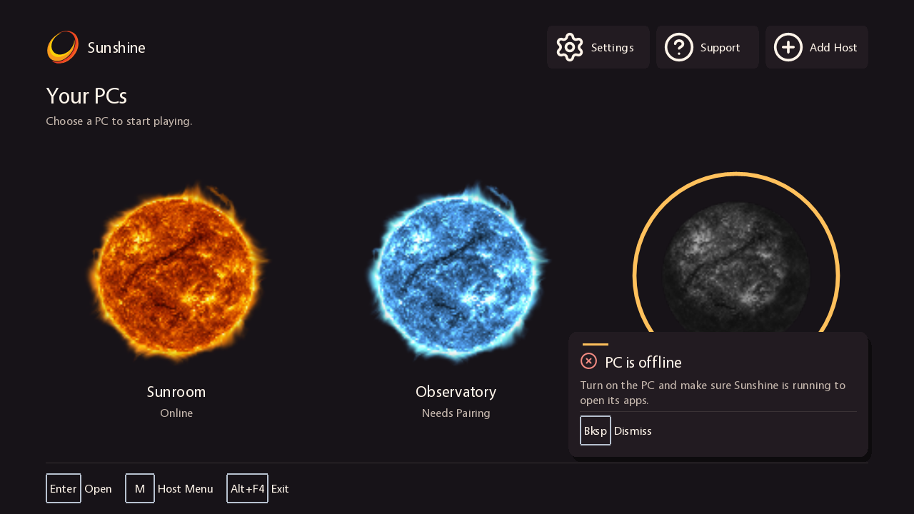

## Android screen layouts

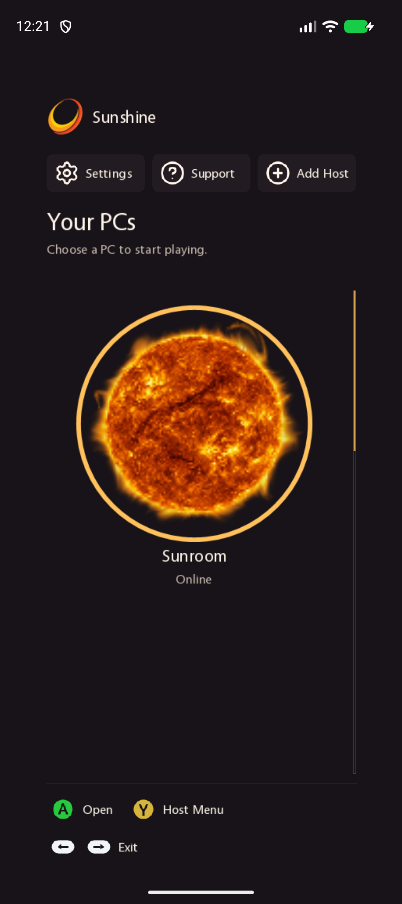

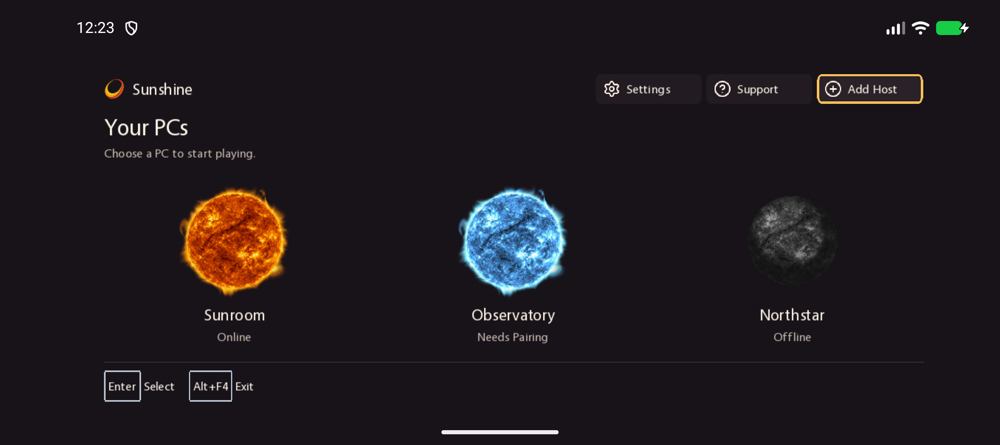

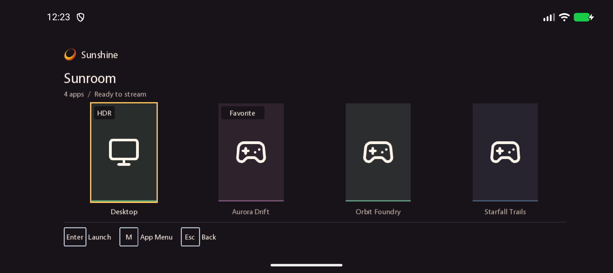

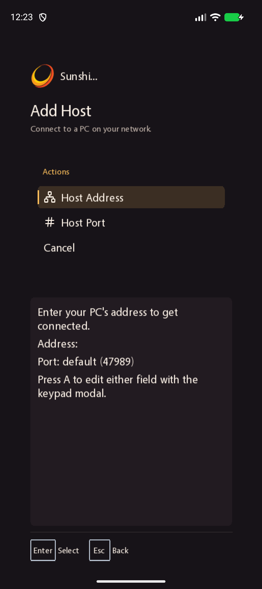

## Refresh the screenshots

Use the screenshot demo to capture the app with the same fictional hosts and app library on each
platform. The demo opens on **Your PCs**. Select **Sunroom** to open its library.
**Observatory** shows the blue sun for a PC awaiting pairing, and **Northstar** shows the offline
state. The demo uses isolated storage and disables live discovery, polling, pairing, and streaming.

Run the Windows and Xbox commands from the repository root in the MSYS2 UCRT64 shell. Use dedicated
build directories so the regular CLion profiles retain their normal behavior.

### Windows

```bash
cmake --preset client-ucrt64 -B cmake-build-screenshots-windows -DSUNSHINE_SCREENSHOT_DEMO=ON
cmake --build cmake-build-screenshots-windows --target sunshine_client --parallel
SDL_VIDEO_DRIVER=offscreen SDL_AUDIO_DRIVER=dummy SDL_RENDER_DRIVER=software \
  SUNSHINE_SCREENSHOT_OUTPUT_DIR="$(cygpath -m "$PWD/docs/images/screenshots")" \
  ./cmake-build-screenshots-windows/SunshineClientDemo.exe
```

The client exports the splash, host browser, and library as PNGs. Launch it without
`SUNSHINE_SCREENSHOT_OUTPUT_DIR` to browse the same demo interactively.

### Original Xbox

```bash
cmake --preset 'xbox-release (ucrt64)' -B cmake-build-screenshots-xbox -DSUNSHINE_SCREENSHOT_DEMO=ON
cmake --build cmake-build-screenshots-xbox --target sunshine_xbox --parallel
```

Load `cmake-build-screenshots-xbox/SunshineDemo.iso` in xemu, maximize the window, and capture the
guest display. Reset the guest to replay the splash.

### Android

```bash
bash packaging/android/gradlew -p packaging/android :app:assembleDebug -PsunshineScreenshotDemo=true
adb install -r packaging/android/app/build/outputs/apk/debug/app-debug.apk
adb shell am start -n dev.lizardbyte.app.sunshineclient.demo/dev.lizardbyte.app.sunshineclient.SunshineActivity
adb shell screencap -p /sdcard/sunshine-screenshot.png
adb pull /sdcard/sunshine-screenshot.png
```

The demo installs alongside the normal app. Add `-s <serial>` after `adb` if multiple devices
or emulators are connected. For the Windows shell and native dependency setup, see
[Testing on Android and Android TV](test-android.md).

Use PNG and replace the corresponding image in `docs/images/screenshots`. Run the strict Dockle
`api` build and check the gallery in the generated documentation.
